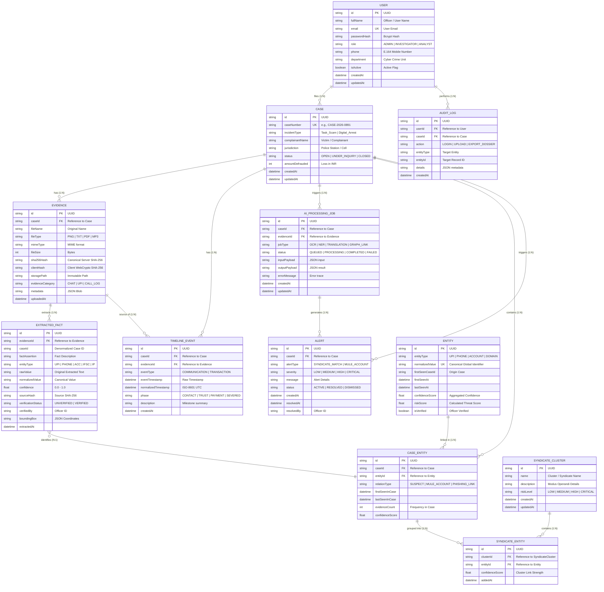

# Rakshak (रक्षक)

> **Forensic Digital Evidence Intake & Cross-Case Syndicate Intelligence Platform**  
> Built for cybercrime cells, forensic investigators, and law enforcement agencies to eliminate AI hallucinations, automate cross-jurisdiction fraud syndicate discovery, and establish statutory cryptographic chain of custody.

---

## 📑 Table of Contents
- [🏛️ System Architecture](#️-system-architecture)
- [🗄️ Entity-Relationship (ER) Diagram & Data Models](#️-entity-relationship-er-diagram--data-models)
  - [Visual ER Diagram](#visual-er-diagram)
  - [Entity Dictionary](#entity-dictionary)
  - [Graph & Relational Models](#graph--relational-models)
  - [Validation & Regular Expressions](#validation--regular-expressions)
- [⚖️ System Rules & Forensic Constraints](#️-system-rules--forensic-constraints)
  - [1. Forensic Integrity Rules](#1-forensic-integrity-rules)
  - [2. Legal Boundaries & Guardrails](#2-legal-boundaries--guardrails)
  - [3. Engineering Directives](#3-engineering-directives)
- [🚀 Quick Start & Installation](#-quick-start--installation)
- [📚 Core Documentation References](#-core-documentation-references)

---

## 🏛️ System Architecture

Rakshak implements an immutable, verifiable ingestion pipeline designed to prevent data tampering, ensure deterministic entity extraction, and resolve fraud syndicates in real time.

### Pipeline Flow

```
[Browser / Client]
│
├── 1. Compute Client SHA-256 (Web Crypto API)
├── 2. Decoupled Upload to Storage
▼
[Next.js API Routes / Backend Gateway]
│
├── Ingestion & Verification Worker
│     ├── File Hash Validation Check (Client vs Server Digest)
│     └── Buffer Duplication (Original Immutable vs Working Copy)
│
├── Extraction Engine (Hybrid Pipeline)
│     ├── OCR / Vision Engine (Tesseract.js / Multimodal LLM)
│     ├── Deterministic Regex Filtering (UPI, Phone, Accounts, IFSC)
│     └── Named Entity Structuring (Zod Output Validation)
│
├── Timeline Normalizer Engine
│     └── Multi-format Date-time parsing to ISO-8601 UTC series
│
├── Cross-Case Graph Resolver
│     ├── Query: MATCH (c:Case)-[:HAS]->(e:Entity {value: $val})
│     └── Degree Trigger (>1) ➔ Generate Syndicate Alert Node
│
▼
[SQLite / PostgreSQL Database via Prisma] + [In-Memory Graph Engine / React Flow]
```

### Component Stack
* **Frontend:** Next.js (App Router), Vanilla CSS / Tailwind CSS, Lucide Icons, Custom High-Security Forensic Theme.
* **Graph Visualization:** `@xyflow/react` (React Flow) / Interactive In-Memory Graph Canvas.
* **Security & Ingestion:** Browser Native Web Crypto API (`crypto.subtle.digest`), Node.js `crypto` server verification, Local/S3 cold storage.
* **Extraction:** Hybrid deterministic Regex-first extraction, contextual NER, strictly validated via Zod schemas.
* **Timeline Engine:** Multi-format parser (WhatsApp, Bank SMS, Gateway logs) normalized to ISO-8601 UTC with IST offset correction and Modus Operandi phase mapping.
* **PDF & Dossier Engine:** Automated BSA §63 electronic evidence certificate and audit-ready dossier generator.

---

## 🗄️ Entity-Relationship (ER) Diagram & Data Models

### 1. Conceptual Chen-Notation ER Diagram

```mermaid
flowchart TB
    %% Styling Classes
    classDef entity fill:#b8d5ff,stroke:#2b6cb0,stroke-width:2px,font-weight:bold,color:#1a365d;
    classDef relationship fill:#ffd6d6,stroke:#c53030,stroke-width:2px,font-weight:bold,color:#742a2a;
    classDef attr fill:#e6fffa,stroke:#319795,stroke-width:1.5px,color:#234e52;
    classDef pk fill:#d4edda,stroke:#28a745,stroke-width:2px,font-weight:bold,color:#155724;

    %% ─── ENTITIES ───
    User["User"]:::entity
    Case["Case"]:::entity
    Evidence["Evidence"]:::entity
    ExtractedFact["ExtractedFact"]:::entity
    TimelineEvent["TimelineEvent"]:::entity
    AuditLog["AuditLog"]:::entity
    AIProcessingJob["AIProcessingJob"]:::entity
    Alert["Alert"]:::entity
    Entity["Entity"]:::entity
    CaseEntity["CaseEntity"]:::entity
    SyndicateEntity["SyndicateEntity"]:::entity
    SyndicateCluster["SyndicateCluster"]:::entity

    %% ─── RELATIONSHIPS (Diamonds) ───
    rel_files{"files"}:::relationship
    rel_performs{"performs"}:::relationship
    rel_case_has_evidence{"has"}:::relationship
    rel_case_has_timeline{"has"}:::relationship
    rel_triggers{"triggers"}:::relationship
    rel_extracts{"extracts"}:::relationship
    rel_source_of{"source of"}:::relationship
    rel_identifies{"identifies"}:::relationship
    rel_linked_in{"linked in"}:::relationship
    rel_grouped_into{"grouped into"}:::relationship
    rel_contains{"contains"}:::relationship
    rel_generates{"generates"}:::relationship

    %% ─── RELATIONSHIP CONNECTIONS WITH CARDINALITIES ───
    User ---|1| rel_files ---|N| Case
    User ---|1| rel_performs ---|N| AuditLog
    Case ---|1| rel_case_has_evidence ---|N| Evidence
    Case ---|1| rel_case_has_timeline ---|N| TimelineEvent
    Case ---|1| rel_triggers ---|N| AIProcessingJob
    Evidence ---|1| rel_extracts ---|N| ExtractedFact
    Evidence ---|1| rel_source_of ---|N| TimelineEvent
    ExtractedFact ---|N| rel_identifies ---|1| CaseEntity
    Entity ---|1| rel_linked_in ---|N| CaseEntity
    CaseEntity ---|1| rel_grouped_into ---|N| SyndicateEntity
    SyndicateCluster ---|1| rel_contains ---|N| SyndicateEntity
    AIProcessingJob ---|1| rel_generates ---|N| Alert

    %% ─── ATTRIBUTES: USER ───
    u_id(["<u>id</u>"]):::pk --- User
    u_fullName(["fullName"]):::attr --- User
    u_email(["email"]):::attr --- User
    u_passwordHash(["passwordHash"]):::attr --- User
    u_role(["role"]):::attr --- User
    u_phone(["phone"]):::attr --- User
    u_dept(["department"]):::attr --- User
    u_isActive(["isActive"]):::attr --- User
    u_createdAt(["createdAt"]):::attr --- User
    u_updatedAt(["updatedAt"]):::attr --- User

    %% ─── ATTRIBUTES: CASE ───
    c_id(["<u>id</u>"]):::pk --- Case
    c_caseNumber(["caseNumber"]):::attr --- Case
    c_incidentType(["incidentType"]):::attr --- Case
    c_compName(["complainantName"]):::attr --- Case
    c_jurisdiction(["jurisdiction"]):::attr --- Case
    c_status(["status"]):::attr --- Case
    c_amount(["amountDefrauded"]):::attr --- Case
    c_createdAt(["createdAt"]):::attr --- Case
    c_updatedAt(["updatedAt"]):::attr --- Case

    %% ─── ATTRIBUTES: EVIDENCE ───
    ev_id(["<u>id</u>"]):::pk --- Evidence
    ev_caseId(["caseId"]):::attr --- Evidence
    ev_fileName(["fileName"]):::attr --- Evidence
    ev_fileType(["fileType"]):::attr --- Evidence
    ev_mimeType(["mimeType"]):::attr --- Evidence
    ev_fileSize(["fileSize"]):::attr --- Evidence
    ev_sha256(["sha256Hash"]):::attr --- Evidence
    ev_clientHash(["clientHash"]):::attr --- Evidence
    ev_storagePath(["storagePath"]):::attr --- Evidence
    ev_category(["evidenceCategory"]):::attr --- Evidence
    ev_metadata(["metadata"]):::attr --- Evidence
    ev_uploadedAt(["uploadedAt"]):::attr --- Evidence

    %% ─── ATTRIBUTES: EXTRACTED FACT ───
    ef_id(["<u>id</u>"]):::pk --- ExtractedFact
    ef_evId(["evidenceId"]):::attr --- ExtractedFact
    ef_caseId(["caseId"]):::attr --- ExtractedFact
    ef_assertion(["factAssertion"]):::attr --- ExtractedFact
    ef_entityType(["entityType"]):::attr --- ExtractedFact
    ef_rawVal(["rawValue"]):::attr --- ExtractedFact
    ef_normVal(["normalizedValue"]):::attr --- ExtractedFact
    ef_conf(["confidence"]):::attr --- ExtractedFact
    ef_srcHash(["sourceHash"]):::attr --- ExtractedFact
    ef_vStatus(["verificationStatus"]):::attr --- ExtractedFact
    ef_vBy(["verifiedBy"]):::attr --- ExtractedFact
    ef_bbox(["boundingBox"]):::attr --- ExtractedFact
    ef_extAt(["extractedAt"]):::attr --- ExtractedFact

    %% ─── ATTRIBUTES: TIMELINE EVENT ───
    te_id(["<u>id</u>"]):::pk --- TimelineEvent
    te_caseId(["caseId"]):::attr --- TimelineEvent
    te_evId(["evidenceId"]):::attr --- TimelineEvent
    te_eType(["eventType"]):::attr --- TimelineEvent
    te_eTs(["eventTimestamp"]):::attr --- TimelineEvent
    te_nTs(["normalizedTimestamp"]):::attr --- TimelineEvent
    te_phase(["phase"]):::attr --- TimelineEvent
    te_desc(["description"]):::attr --- TimelineEvent
    te_cAt(["createdAt"]):::attr --- TimelineEvent

    %% ─── ATTRIBUTES: AUDIT LOG ───
    al_id(["<u>id</u>"]):::pk --- AuditLog
    al_uId(["userId"]):::attr --- AuditLog
    al_cId(["caseId"]):::attr --- AuditLog
    al_action(["action"]):::attr --- AuditLog
    al_eType(["entityType"]):::attr --- AuditLog
    al_eId(["entityId"]):::attr --- AuditLog
    al_details(["details"]):::attr --- AuditLog
    al_cAt(["createdAt"]):::attr --- AuditLog

    %% ─── ATTRIBUTES: AI PROCESSING JOB ───
    aj_id(["<u>id</u>"]):::pk --- AIProcessingJob
    aj_cId(["caseId"]):::attr --- AIProcessingJob
    aj_evId(["evidenceId"]):::attr --- AIProcessingJob
    aj_jType(["jobType"]):::attr --- AIProcessingJob
    aj_status(["status"]):::attr --- AIProcessingJob
    aj_inPayload(["inputPayload"]):::attr --- AIProcessingJob
    aj_outPayload(["outputPayload"]):::attr --- AIProcessingJob
    aj_errMsg(["errorMessage"]):::attr --- AIProcessingJob
    aj_cAt(["createdAt"]):::attr --- AIProcessingJob
    aj_uAt(["updatedAt"]):::attr --- AIProcessingJob

    %% ─── ATTRIBUTES: ALERT ───
    alt_id(["<u>id</u>"]):::pk --- Alert
    alt_cId(["caseId"]):::attr --- Alert
    alt_aType(["alertType"]):::attr --- Alert
    alt_sev(["severity"]):::attr --- Alert
    alt_msg(["message"]):::attr --- Alert
    alt_status(["status"]):::attr --- Alert
    alt_cAt(["createdAt"]):::attr --- Alert
    alt_rAt(["resolvedAt"]):::attr --- Alert
    alt_rBy(["resolvedBy"]):::attr --- Alert

    %% ─── ATTRIBUTES: ENTITY ───
    ent_id(["<u>id</u>"]):::pk --- Entity
    ent_eType(["entityType"]):::attr --- Entity
    ent_nVal(["normalizedValue"]):::attr --- Entity
    ent_fCaseId(["firstSeenCaseId"]):::attr --- Entity
    ent_fSeenAt(["firstSeenAt"]):::attr --- Entity
    ent_lSeenAt(["lastSeenAt"]):::attr --- Entity
    ent_conf(["confidenceScore"]):::attr --- Entity
    ent_risk(["riskScore"]):::attr --- Entity
    ent_isVer(["isVerified"]):::attr --- Entity

    %% ─── ATTRIBUTES: CASE ENTITY ───
    ce_id(["<u>id</u>"]):::pk --- CaseEntity
    ce_cId(["caseId"]):::attr --- CaseEntity
    ce_entId(["entityId"]):::attr --- CaseEntity
    ce_relType(["relationType"]):::attr --- CaseEntity
    ce_fSeen(["firstSeenInCase"]):::attr --- CaseEntity
    ce_lSeen(["lastSeenInCase"]):::attr --- CaseEntity
    ce_evCnt(["evidenceCount"]):::attr --- CaseEntity
    ce_conf(["confidenceScore"]):::attr --- CaseEntity

    %% ─── ATTRIBUTES: SYNDICATE ENTITY ───
    se_id(["<u>id</u>"]):::pk --- SyndicateEntity
    se_cluId(["clusterId"]):::attr --- SyndicateEntity
    se_entId(["entityId"]):::attr --- SyndicateEntity
    se_conf(["confidenceScore"]):::attr --- SyndicateEntity
    se_addAt(["addedAt"]):::attr --- SyndicateEntity

    %% ─── ATTRIBUTES: SYNDICATE CLUSTER ───
    sc_id(["<u>id</u>"]):::pk --- SyndicateCluster
    sc_name(["name"]):::attr --- SyndicateCluster
    sc_desc(["description"]):::attr --- SyndicateCluster
    sc_risk(["riskLevel"]):::attr --- SyndicateCluster
    sc_cAt(["createdAt"]):::attr --- SyndicateCluster
    sc_uAt(["updatedAt"]):::attr --- SyndicateCluster
```



---

### 2. Relational Schema & Foreign Key Mapping (Crow's Foot Notation)



---

### 3. Entity & Relationship Dictionary

| Entity | Description | Attributes | Cardinality & Relationships |
| :--- | :--- | :--- | :--- |
| **`User`** | Investigating officers, cyber analysts, and administrators. | `id` (PK), `fullName`, `email`, `passwordHash`, `role`, `phone`, `department`, `isActive`, `createdAt`, `updatedAt` | `1 : N` $\rightarrow$ `Case` (`files`), `1 : N` $\rightarrow$ `AuditLog` (`performs`) |
| **`Case`** | Core cybercrime incident registered in the system. | `id` (PK), `caseNumber`, `incidentType`, `complainantName`, `jurisdiction`, `status`, `amountDefrauded`, `createdAt`, `updatedAt` | `1 : N` $\rightarrow$ `Evidence` (`has`), `1 : N` $\rightarrow$ `TimelineEvent` (`has`), `1 : N` $\rightarrow$ `AIProcessingJob` (`triggers`) |
| **`Evidence`** | Binary evidence vault items (images, audio, PDF) with dual SHA-256 verification. | `id` (PK), `caseId` (FK), `fileName`, `fileType`, `mimeType`, `fileSize`, `sha256Hash`, `clientHash`, `storagePath`, `evidenceCategory`, `metadata`, `uploadedAt` | `1 : N` $\rightarrow$ `ExtractedFact` (`extracts`), `1 : N` $\rightarrow$ `TimelineEvent` (`source of`) |
| **`ExtractedFact`** | Discrete forensic extractions with bounding coordinates and provenance hashes. | `id` (PK), `evidenceId` (FK), `caseId`, `factAssertion`, `entityType`, `rawValue`, `normalizedValue`, `confidence`, `sourceHash`, `verificationStatus`, `verifiedBy`, `boundingBox`, `extractedAt` | `N : 1` $\rightarrow$ `CaseEntity` (`identifies`) |
| **`TimelineEvent`** | Reconstructed chronological event milestone across communications and transactions. | `id` (PK), `caseId` (FK), `evidenceId` (FK), `eventType`, `eventTimestamp`, `normalizedTimestamp`, `phase`, `description`, `createdAt` | Sourced from `Evidence` (N:1) & attached to `Case` (N:1) |
| **`AuditLog`** | Immutable forensic access log tracking officer actions and export events. | `id` (PK), `userId` (FK), `caseId` (FK), `action`, `entityType`, `entityId`, `details`, `createdAt` | Performed by `User` (N:1) |
| **`AIProcessingJob`** | Async queue tracking background AI OCR, translation, and graph inference workers. | `id` (PK), `caseId` (FK), `evidenceId` (FK), `jobType`, `status`, `inputPayload`, `outputPayload`, `errorMessage`, `createdAt`, `updatedAt` | Triggered by `Case` (N:1), `1 : N` $\rightarrow$ `Alert` (`generates`) |
| **`Alert`** | Real-time cross-case syndicate match or high-risk mule account notifications. | `id` (PK), `caseId` (FK), `alertType`, `severity`, `message`, `status`, `createdAt`, `resolvedAt`, `resolvedBy` | Generated by `AIProcessingJob` (N:1) |
| **`Entity`** | Global canonical repository of unique extracted identifiers across all cases. | `id` (PK), `entityType`, `normalizedValue` (UK), `firstSeenCaseId`, `firstSeenAt`, `lastSeenAt`, `confidenceScore`, `riskScore`, `isVerified` | `1 : N` $\rightarrow$ `CaseEntity` (`linked in`) |
| **`CaseEntity`** | Association connecting an individual Case to specific global Entities. | `id` (PK), `caseId` (FK), `entityId` (FK), `relationType`, `firstSeenInCase`, `lastSeenInCase`, `evidenceCount`, `confidenceScore` | `1 : N` $\rightarrow$ `SyndicateEntity` (`grouped into`) |
| **`SyndicateEntity`** | Junction linking global entities to syndicate fraud rings. | `id` (PK), `clusterId` (FK), `entityId` (FK), `confidenceScore`, `addedAt` | Belongs to `SyndicateCluster` (N:1) and `CaseEntity` (N:1) |
| **`SyndicateCluster`** | Aggregated fraud syndicates / crime rings sharing common financial/telecom infrastructure. | `id` (PK), `name`, `description`, `riskLevel`, `createdAt`, `updatedAt` | `1 : N` $\rightarrow$ `SyndicateEntity` (`contains`) |

---

### 4. Forensic Validation & Regex Standards
* **UPI VPA:** `^[a-zA-Z0-9.\-_]{2,256}@[a-zA-Z]{2,64}$`
* **Indian Mobile (E.164):** `^(?:\+91|0)?[6-9]\d{9}$`
* **IFSC Code:** `^[A-Z]{4}0[A-Z0-9]{6}$`
* **SHA-256 Digest:** `^[a-fA-F0-9]{64}$`
* **UTR / Transaction Reference:** `\b(?:\d{12}|[A-Z0-9]{12,22})\b`

---

## ⚖️ System Rules & Forensic Constraints

### 1. Forensic Integrity Rules
1. **Immutable Storage:** Original binary files are write-once and never mutated. All format transformations, OCR preprocessing, and waveform analysis operate strictly on in-memory buffers. Original SHA-256 checksums remain identical.
2. **Zero Unanchored Assertions:** The AI engine is prohibited from generating entities or conclusions without a bidirectional link to an uploaded `evidence_id` and bounding box / offset. Unanchored hallucinated claims are dropped.

### 2. Legal Boundaries & Guardrails
1. **Investigative Intelligence Tool:** The platform does not claim to convict or automate judicial sentencing.
2. **Qualified Language:** All outputs use qualified evidentiary terms such as *"Potential Syndicate Match Detected"* or *"High-Risk Common Identifier"* rather than unverified definitive assertions.
3. **Statutory Admissibility (BSA §63):** Produces automated electronic record certificates meeting Section 63 of Bharatiya Sakshya Adhiniyam (BSA) standards.

### 3. Engineering Directives
1. **Deterministic Cross-Case Matching:** Pre-seeded with realistic fraud patterns (`badguy@okicici`, `+919876543210`) so demo uploads immediately link to multi-jurisdiction clusters.
2. **High-Performance Resolution:** Graph resolution operates in-memory for instant $<5$ second multi-file analysis.

---

## 🚀 Quick Start & Installation

### 1. Install Dependencies
```bash
npm install
```

### 2. Initialize Database & Seed
```bash
npx prisma generate
npx prisma migrate dev --name init
npm run db:seed
```

### 3. Start Development Server
```bash
npm run dev
```

Open [https://rakshak-six-mu.vercel.app/](https://rakshak-six-mu.vercel.app/) to view the Rakshak Forensic Dashboard.

---

## 📚 Core Documentation References

- 📄 [Product Requirement Document (PRD)](file:///e:/Rakshak/prd.md) — Functional requirements, persona journeys, and scope.
- 🗄️ [Data Requirement Document (DRD)](file:///e:/Rakshak/drd.md) — Database schema specifications and graph topologies.
- 🏛️ [System Architecture](file:///e:/Rakshak/architecture.md) — Technical pipeline and subsystem flow.
- ⚖️ [System Rules & Constraints](file:///e:/Rakshak/rules.md) — Forensic and legal guardrails.
- 🔬 [5 Technical Pillars & Innovations](file:///e:/Rakshak/technical_pillars.md) — Deep dive into the forensic engines.
- 🗺️ [Implementation Roadmap & Phases](file:///e:/Rakshak/phases.md) — Milestone tracking.
