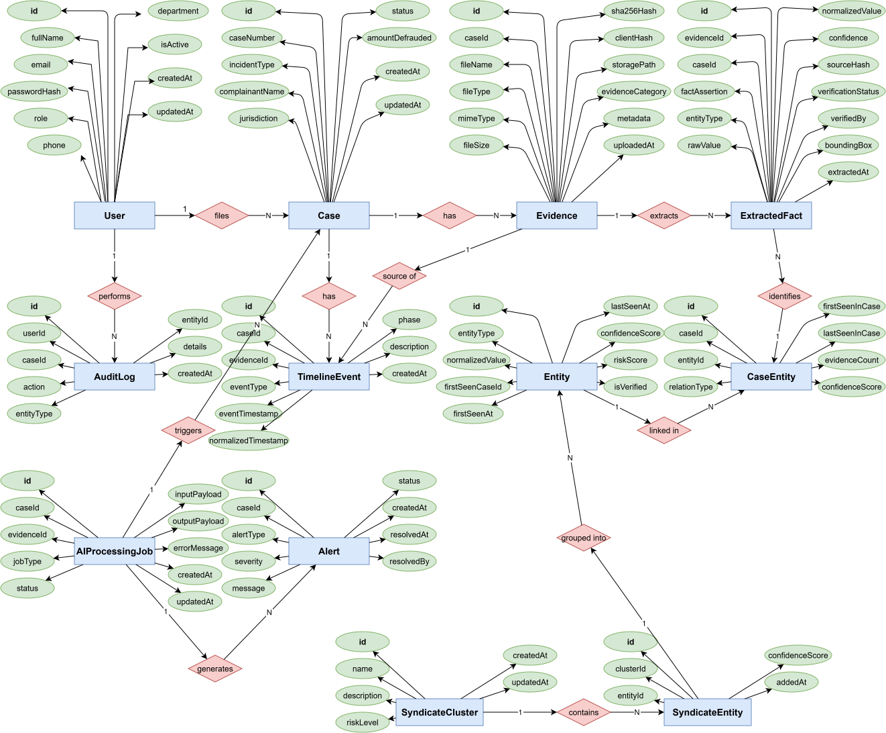

# Rakshak (रक्षक) v3.0

> **Forensic Digital Evidence Intake & Cross-Case Syndicate Intelligence Platform**  
> Built for cybercrime cells, state forensic laboratories, and law enforcement agencies to eliminate AI hallucinations, automate cross-jurisdiction fraud syndicate discovery, establish statutory cryptographic chain of custody, and generate Section 63 BSA compliance certificates.

---

## 📑 Table of Contents
- [🌟 Key Innovations & Forensic Capabilities](#-key-innovations--forensic-capabilities)
- [🏛️ System Architecture](#️-system-architecture)
- [💻 Unified Neumorphic Interface (11 Core Modules)](#-unified-neumorphic-interface-11-core-modules)
- [🗄️ Entity-Relationship (ER) Diagram & Data Dictionary](#️-entity-relationship-er-diagram--data-dictionary)
- [⚖️ Statutory Admissibility (BSA 2023 §63) & System Rules](#️-statutory-admissibility-bsa-2023-63--system-rules)
- [🛡️ Security Invariants & Storage Immutability](#️-security-invariants--storage-immutability)
- [🚀 Quick Start & Installation](#-quick-start--installation)
- [🧪 Automated Verification & Testing](#-automated-verification--testing)
- [📚 Core Documentation References](#-core-documentation-references)

---

## 🌟 Key Innovations & Forensic Capabilities

1. **Dual SHA-256 Web Crypto Intake & WORM Immutability:**  
   Calculates file hashes client-side via the Web Crypto API before upload, verifies identically server-side with Node.js `crypto`, and persists exhibits to Write-Once-Read-Many (WORM) content-addressed cold storage (`/uploads/raw/<sha256>.bin`). Any byte alteration triggers instant rejection.
2. **Deterministic-First Extraction (Zero AI Hallucinations):**  
   Strict deterministic regex filters for Indian financial and telecom identifiers (UPI VPAs, Indian Mobile numbers, IFSC codes, UTR transaction references) paired with offline dual-OCR (`pdf-parse` + `Tesseract.js` v5 with offline `eng.traineddata`). Every fact is bidirectionally grounded to an exhibit offset.
3. **Cross-Case Syndicate Graph Resolver:**  
   Bipartite graph engine (`services/graphService.ts`) detects multi-jurisdiction cybercrime rings in real time. Shared identifiers (mule accounts, phone numbers) trigger instant crimson/amber syndicate alerts on an interactive D3 force-directed canvas.
4. **Timeline Normalization & Modus Operandi (MO) Mapping:**  
   Normalizes multi-source timestamp formats (WhatsApp exports, bank SMS, gateway logs) into ISO-8601 UTC chronological sequences and automatically classifies events into the 4 cybercrime operational phases: *Reconnaissance*, *Bait & Impersonation*, *Transaction & Extraction*, and *Laundering & Cashout*.
5. **Bharatiya Sakshya Adhiniyam (BSA) 2023 §63 Compliance:**  
   Automated generation of court-admissible Section 63 electronic record certificates and forensic dossiers, capturing hash signatures, officer credentials, device hashes, and an immutable chain of custody.
6. **Dual-Engine Persistence with PostgreSQL Row-Level Security (RLS):**  
   Zero-dependency offline SQLite database for air-gapped field deployments, with seamless enterprise cutover to PostgreSQL 16 enforcing cryptographically bounded department isolation via `app.current_department_id`.
7. **Unified 10-Item Neumorphic Navigation:**  
   Synchronized canonical navigation bar across all 11 modules with zero layout shift, smooth active states, and instant client-side forwarders for legacy URLs.

---

## 🏛️ System Architecture

```
[ BROWSER / CLIENT ]
 │
 ├── 1. Compute Client SHA-256 Digest (Web Crypto API)
 ├── 2. Client-side Metadata Extraction & Zero-Trust Check
 ▼
[ NEXT.JS API GATEWAY / BACKEND ]
 │
 ├── Ingestion & Verification Worker
 │     ├── Dual Hash Validation (Client vs Server Digest)
 │     └── Buffer Duplication (Original Immutable .bin vs Working Copy)
 │
 ├── Extraction Engine (Hybrid Pipeline)
 │     ├── Dual OCR Engine (pdf-parse + Tesseract.js offline)
 │     ├── Deterministic Regex Filtering (UPI, Mobile, Bank Accounts, IFSC, UTR)
 │     └── Named Entity Structuring (Strict Zod Schema Validation)
 │
 ├── Timeline Normalizer Engine
 │     ├── Multi-format timestamp parser to ISO-8601 UTC series (+05:30 IST offset)
 │     └── Modus Operandi (MO) 4-phase tagger
 │
 ├── Cross-Case Graph Resolver
 │     ├── Query: MATCH (c:Case)-[:HAS]->(e:Entity {value: $val})
 │     └── Degree Trigger (>1) ➔ Generate Syndicate Alert Node & Clusters
 │
 ▼
[ DATA PERSISTENCE LAYER ]
 ├── Development / Air-gapped: Local SQLite (prisma/dev.db)
 └── Enterprise Multi-Agency: PostgreSQL 16 with native Row-Level Security (RLS)
```

---

## 💻 Unified Neumorphic Interface (11 Core Modules)

Rakshak v3.0 features an ultra-clean, modern Neumorphic design system (`#E9EEF5` surface, `#F5F8FC` cards, `#172B4D` typography, soft dual-drop shadows) with a consistent 10-item left navigation bar across all pages:

| Module | File | Core Functionality |
| :--- | :--- | :--- |
| **01. Dashboard** | [`dashboard.html`](file:///e:/Rakshak/public/frontend/pages/dashboard.html) | Real-time command center, case statistics, recent evidence ingestions, live syndicate alert notifications, rapid triage buttons. |
| **02. Cases** | [`cases.html`](file:///e:/Rakshak/public/frontend/pages/cases.html) | Master case directory, search and filtering by severity, status, and jurisdiction, case creation modal, deep-linked case dossiers. |
| **03. Evidence Vault** | [`evidence.html`](file:///e:/Rakshak/public/frontend/pages/evidence.html) | Dual-hash evidence repository, drag-and-drop ingest dropzone, WORM integrity verification, OCR text inspection, chain of custody logs. |
| **04. Reports & Legal** | [`reports.html`](file:///e:/Rakshak/public/frontend/pages/reports.html) | Automated BSA § 63 digital compliance certificates, comprehensive forensic dossiers, PDF downloads, and annexure management. |
| **05. Intelligence Graph** | [`graph.html`](file:///e:/Rakshak/public/frontend/pages/graph.html) | Interactive D3/SVG network graph, real-time node resolution, crimson syndicate cross-case badges, and shared mule account clusters. |
| **06. Entities** | [`entities.html`](file:///e:/Rakshak/public/frontend/pages/entities.html) | Global intelligence repository for extracted identifiers (Mule accounts, UPI VPAs, Phone numbers, IFSC, Devices, Wallets). |
| **07. Timeline** | [`timeline.html`](file:///e:/Rakshak/public/frontend/pages/timeline.html) | Unified chronological event sequence, Modus Operandi (MO) stage progression mapping, and source document traceability. |
| **08. Cross-Department** | [`cross-dept.html`](file:///e:/Rakshak/public/frontend/pages/cross-dept.html) | Inter-agency intelligence exchange, multi-jurisdiction case-sharing requests, and native Institutional Department Onboarding modal. |
| **09. Administration** | [`admin.html`](file:///e:/Rakshak/public/frontend/pages/admin.html) | Officer management, Role-Based Access Control (RBAC), department tenancy configuration, security toggles, and system telemetry. |
| **10. Audit Logs** | [`audit.html`](file:///e:/Rakshak/public/frontend/pages/audit.html) | Append-only tamper-evident security activity monitor, filter by actor, action, and severity, CSV/JSON compliance exports. |
| **11. Authentication** | [`index.html`](file:///e:/Rakshak/public/frontend/pages/index.html) | High-security officer login portal with strict credential validation and HttpOnly session cookie governance. |

---

## 🗄️ Entity-Relationship (ER) Diagram & Data Dictionary

<div align="center">



</div>

### Key Data Models & Relations

| Entity | Description | Primary Key | Key Relations |
| :--- | :--- | :--- | :--- |
| **`User`** | Investigating officers, cyber analysts, and platform administrators. | `id` (PK) | `1:N` Cases, `1:N` AuditLogs |
| **`Case`** | Core cybercrime incident registered in the system. | `id` (PK) | `1:N` Evidence, `1:N` TimelineEvents, `1:N` CaseEntities |
| **`Evidence`** | Binary exhibits stored in cold storage with dual SHA-256 verification. | `id` (PK) | `1:N` ExtractedFacts, `1:N` TimelineEvents |
| **`ExtractedFact`** | Discrete forensic extractions with provenance offsets and bounding boxes. | `id` (PK) | Belongs to `Evidence`, identifies `CaseEntity` |
| **`TimelineEvent`** | Reconstructed chronological event milestone across communications and transactions. | `id` (PK) | Sourced from `Evidence`, attached to `Case` |
| **`Entity`** | Global canonical repository of unique extracted identifiers across all cases. | `id` (PK) | `1:N` CaseEntities |
| **`CaseEntity`** | Junction connecting an individual Case to global Entities. | `id` (PK) | `1:N` SyndicateEntities |
| **`SyndicateCluster`**| Aggregated fraud rings sharing common infrastructure or mule accounts. | `id` (PK) | `1:N` SyndicateEntities |
| **`AuditLog`** | Immutable append-only forensic audit trail. | `id` (PK) | Performed by `User` |

---

## ⚖️ Statutory Admissibility (BSA 2023 §63) & System Rules

### 1. Forensic Integrity Rules
* **Immutable Storage:** Original files are written once to `/uploads/raw/<sha256>.bin` and never modified. All OCR and processing occurs on in-memory working buffers.
* **Zero Unanchored Assertions:** AI and extraction engines are strictly prohibited from generating entities or conclusions without a bidirectional anchor to an uploaded `evidence_id` and byte/bounding box offset.

### 2. Legal Boundaries & Guardrails
* **Investigative Intelligence Tool:** The platform generates intelligence to assist law enforcement; it does not claim to automate judicial verdicts.
* **Qualified Evidentiary Language:** Outputs use calibrated forensic terminology such as *"Potential Syndicate Match Detected"* rather than unverified definitive assertions.
* **Section 63 Certificate:** Produces automated, cryptographically validated electronic record certificates complying with Section 63 of Bharatiya Sakshya Adhiniyam (BSA) 2023.

---

## 🛡️ Security Invariants & Storage Immutability

* **INV-01 (WORM Storage):** Evidence exhibits are identified and persisted strictly by their SHA-256 digest (`/uploads/raw/<sha256>.bin`).
* **INV-02 (Dual-Hash Check):** Client-side Web Crypto digest must match server-side Node.js crypto digest or upload is aborted.
* **INV-03 (Tenant Isolation):** PostgreSQL Row-Level Security restricts queries strictly to the officer's authorized department via `app.current_department_id`.
* **INV-04 (Append-Only Auditing):** Audit logs cannot be modified or deleted (`UPDATE` and `DELETE` blocked at database layer).
* **INV-05 (Directory Traversal Defense):** All file retrieval operations sanitize hashes against strict `^[a-fA-F0-9]{64}$` regex.

---

## 🚀 Quick Start & Installation

### 1. Prerequisites
* Node.js 18+ LTS
* npm or pnpm

### 2. Install Dependencies
```bash
npm install
```

### 3. Initialize Database & Seed
```bash
npx prisma generate
npx prisma migrate dev --name init
npm run db:seed
```

### 4. Start Development Server
```bash
npm run dev
```

Open `http://localhost:3000/frontend/pages/dashboard.html` to access the Rakshak Forensic Console.

---

## 🧪 Automated Verification & Testing

Rakshak includes a comprehensive automated validation suite:

```bash
# 1. Validate TypeScript compilation across all routes and services
npx tsc --noEmit

# 2. Check static frontend integrity across all 18 HTML pages
node scripts/check_frontend_integrity.mjs

# 3. Check JavaScript module imports and asset bindings
node scripts/check_frontend_imports.mjs

# 4. Run Production Preflight Verification (all 14 governance gates)
node scripts/verify_phase29_preflight.mjs
```

---

## 📚 Core Documentation References

- 🏛️ [System Architecture](file:///e:/Rakshak/architecture.md) — Comprehensive technical pipeline, RLS tenancy, and subsystem specifications.
- 📋 [Master Consolidated Phases Report](file:///e:/Rakshak/CONSOLIDATED_PHASES_REPORT.md) — Authoritative record of all 29 delivery milestones, metrics, and KPIs.
- 🗺️ [Implementation Phases & Roadmap](file:///e:/Rakshak/phases.md) — Phase breakdown from initial setup to enterprise production cutover.
- 📄 [Product Requirement Document (PRD)](file:///e:/Rakshak/prd.md) — Functional specifications, persona journeys, and scope.
- 🗄️ [Data Requirement Document (DRD)](file:///e:/Rakshak/drd.md) — Database schema specifications and graph topologies.
- ⚖️ [System Rules & Forensic Constraints](file:///e:/Rakshak/rules.md) — Legal and forensic guardrails.
- 🔬 [5 Technical Pillars & Innovations](file:///e:/Rakshak/technical_pillars.md) — In-depth guide to forensic extraction and graph resolution.
- 🚀 [Deployment Runbook](file:///e:/Rakshak/DEPLOYMENT.md) — Enterprise Docker, Nginx, and PostgreSQL deployment guide.
- 📖 [Administrator Runbook](file:///e:/Rakshak/RAKSHAK_ADMIN_RUNBOOK.md) — Operational guidelines for platform administrators.
