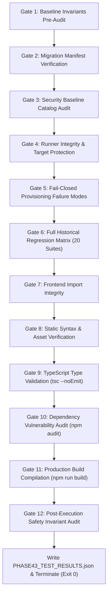

# RAKSHAK v3.0 — PHASE 43
# RELEASE VALIDATION & GATE AUTOMATION OPERATOR'S GUIDE

**Phase:** 43 — Legacy Setup Remediation, Full Regression Revalidation & Release Gate Automation  
**Author:** Rakshak Quality & Security Baseline Automation  
**Date:** 2026-10-25  
**Canonical Command:** `npm run validate:release`  
**Authoritative Provisioning Command:** `npm run db:provision:phase43`  
**Operational Status:** READY FOR CONTROLLED SYNTHETIC-DATA TESTING — PROVISIONING AND REGRESSION GATES REVALIDATED  

---

## 1. Overview & Purpose

This guide provides technical specifications, operational instructions, and troubleshooting procedures for executing the Rakshak v3.0 Release Validation Pipeline.

The pipeline automates all release gating requirements into a single non-interactive orchestrator:
- Cryptographic verification of migration payloads
- Authoritative database provisioning and baseline catalog auditing
- Negative security and fail-closed integrity tests
- Full 20-suite historical regression execution (466 assertions)
- Static code analysis, TypeScript compilation, dependency vulnerability scanning, and Next.js production build verification
- Zero-mutation post-execution safety audits

---

## 2. System Requirements & Prerequisites

Before initiating the release validation pipeline, verify that the host environment conforms to the following dependencies:

| Component | Minimum Version | Required Location / Configuration |
| :--- | :--- | :--- |
| **Node.js** | `>= 20.x` | `node` and `npm` in system `PATH` |
| **PostgreSQL** | `16.x` | Running at `127.0.0.1:5432`, CLI at `C:\Program Files\PostgreSQL\16\bin\psql.exe` |
| **Prisma ORM** | `5.22.0` | Dual clients generated (`@prisma/client` and `@prisma/client-pg`) |
| **TypeScript** | `5.x` | Static typecheck (`tsc --noEmit`) passes cleanly |
| **Cold Storage** | 560 files | `uploads/raw/` with manifest digest `bdc91bb78c603d212d992ac552d8ff85e6e4096bb0533c836ed8936b20ad61b8` |
| **Staging SQLite** | 8,224,768 bytes | `prisma/dev.db` with SHA-256 digest `dd24614b14f1b4cf8413b674e27bba8459eec6c182536537ab085dbd647af3a9` |

---

## 3. Execution Commands & Workflows

### 3.1 Unified Release Validation Pipeline (Primary Gate)

To execute the entire 12-gate release validation process:

```bash
npm run validate:release
```
*Equivalent direct command:*
```bash
node scripts/run_release_validation_pipeline.mjs
```

**Expected Exit Behavior:**
- **Success:** Exit code `0`, summary table logged to stdout, results written to `PHASE43_TEST_RESULTS.json` with `"overallStatus": "PASSED"`.
- **Failure:** Exit code `1` (or non-zero), detailed failure context logged, results written to `PHASE43_TEST_RESULTS.json` with `"overallStatus": "FAILED"`.

### 3.2 Authoritative Database Provisioning (Standalone Rehearsal)

To provision a fresh, isolated test database conforming to the full 11-migration sequence and verified baseline:

```bash
npm run db:provision:phase43
```
*Equivalent direct command:*
```bash
node scripts/setup_phase43_test_db.mjs
```

Or for arbitrary test databases (excluding protected historical databases):
```bash
node scripts/authoritative_migration_runner.mjs <database_name>
```

---

## 4. Pipeline Gate Architecture (12 Gates)

The pipeline executes 12 gates sequentially. Any gate failure triggers a fail-closed aggregate exit code `1`:



### Detailed Gate Specifications

1. **Gate 1: Baseline Safety Invariants Pre-Flight Audit**
   - Validates that `uploads/raw/` contains exactly 560 cold exhibits.
   - Computes initial cryptographic hash of `prisma/dev.db` and directory manifest of `uploads/raw/`.

2. **Gate 2: Authoritative Migration Manifest & Inventory Verification**
   - Cryptographically hashes all 11 `.sql` files in `prisma/migrations_pg/`.
   - Confirms exact match against `expectedSha256` in [`scripts/authoritative_migration_runner.mjs`](file:///e:/Rakshak/scripts/authoritative_migration_runner.mjs).
   - Rejects any untracked or modified migration scripts.

3. **Gate 3: Isolated PostgreSQL Security Baseline Catalog Audit**
   - Queries `information_schema` and `pg_catalog` on `rakshak_phase43_test`.
   - Verifies 31 public tables, 20 RLS-enabled tables, 20 FORCE RLS tables, and 21 tenant isolation policies.
   - Confirms unprivileged `rakshak_app_user` lacks `SUPERUSER`, `BYPASSRLS`, or `CREATEROLE` privileges.

4. **Gate 4: Runner Integrity & Negative Target Selection Tests**
   - Executes [`scripts/test_phase43_runner_integrity.mjs`](file:///e:/Rakshak/scripts/test_phase43_runner_integrity.mjs).
   - Proves fail-closed rejection of empty targets, SQLite files (`dev.db`), directory traversals, protected DBs (`rakshak_phase41_test`), and tampered migration files.

5. **Gate 5: Fail-Closed Provisioning & Security Failure Modes Suite**
   - Executes [`scripts/test_phase42_provisioning_failure_modes.mjs`](file:///e:/Rakshak/scripts/test_phase42_provisioning_failure_modes.mjs).
   - Verifies 10 failure mode scenarios including syntax errors, partial migration rollbacks, missing migrations, and catalog drift.

6. **Gate 6: Full Historical Regression Matrix Execution**
   - Executes 20 sequential test suites (REG-01 through REG-20) covering 466 assertions.
   - Cleans test data between suites via `cleanTestDatabase()` (`TRUNCATE TABLE ... CASCADE;`).

7. **Gate 7: Frontend Import Resolution & Integrity**
   - Executes [`scripts/check_frontend_imports.mjs`](file:///e:/Rakshak/scripts/check_frontend_imports.mjs).
   - Validates static asset links and script dependencies across all frontend pages.

8. **Gate 8: Frontend Static Syntax & Asset Verification**
   - Executes [`scripts/check_frontend_integrity.mjs`](file:///e:/Rakshak/scripts/check_frontend_integrity.mjs).
   - Evaluates vanilla JavaScript syntax using `node --check` across `public/frontend/js/*.js`.

9. **Gate 9: TypeScript Static Compilation**
   - Executes `npx tsc --noEmit`.
   - Confirms strict type conformance across all Next.js API routes and server libraries.

10. **Gate 10: Dependency Vulnerability Security Audit**
    - Executes `npm audit`.
    - Confirms zero high or critical security vulnerabilities in package dependencies.

11. **Gate 11: Production Build Compilation**
    - Executes `npm run build` (`prisma:generate` followed by `next build`).
    - Verifies production bundle generation without errors.

12. **Gate 12: Post-Execution Safety Invariants Audit**
    - Recalculates SHA-256 of `prisma/dev.db` and `uploads/raw/`.
    - Asserts 100% byte-for-byte identity with pre-flight values.

---

## 5. Troubleshooting & Diagnostic Procedures

| Symptom / Error | Root Cause | Resolution |
| :--- | :--- | :--- |
| `FATAL SAFETY VIOLATION: Attempted to target protected historical database` | Script was invoked with a database name matching `rakshak_phase[26-42]_test`. | Choose an unreserved database name (e.g., `rakshak_phase43_rehearsal`). |
| `FATAL SAFETY VIOLATION: Database already exists` | `authoritative_migration_runner.mjs` was invoked without pre-cleaning the database. | Drop the target database manually in PostgreSQL: `DROP DATABASE "<target>";` or use the pipeline's automated isolation. |
| `INTEGRITY ERROR: SHA-256 hash mismatch for <file>.sql` | Migration SQL file on disk was modified or corrupted. | Restore the migration file from version control: `git checkout prisma/migrations_pg/<file>.sql`. |
| `Security baseline failed: table count violation` | Schema push or migration failed to deploy all 31 tables. | Run `npm run db:provision:phase43` to rebuild the schema from scratch. |
| `CustodyEvent_evidence_seq_unique_idx missing` | An external `prisma db push` was run on the database using an unaligned schema. | Ensure `schema.postgresql.prisma` has `@@unique([evidenceId, sequenceNumber])` and re-apply migration 8. |

---

## 6. Deployment Safety Restraints

> [!IMPORTANT]
> **Operational Status: READY FOR CONTROLLED SYNTHETIC-DATA TESTING — PROVISIONING AND REGRESSION GATES REVALIDATED**
>
> All testing and execution must remain strictly confined to the local sandbox environment. The following controls MUST remain enforced:
> - Production cutover disabled.
> - Live investigative data ingestion disabled.
> - External WAN feeds disabled.
> - Production digital signature keys and certificates disabled.
> - Phase 44 development MUST NOT commence until formal release gate approval is logged.
