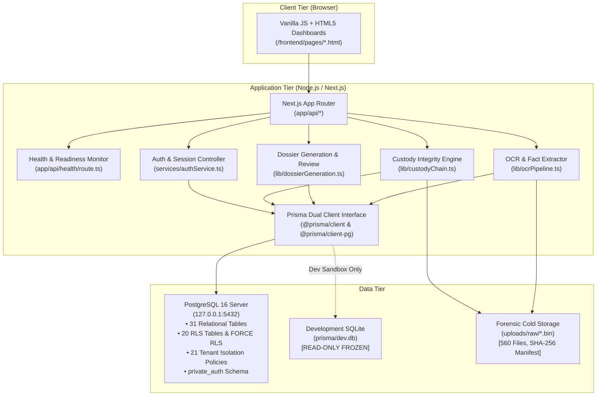

# RAKSHAK v3.0 — PHASE 44
# OPERATIONAL ARCHITECTURE & DEPENDENCY INVENTORY

**Phase:** 44 — Operational Resilience, Backup Recovery & Service Health Verification  
**Author:** Rakshak Quality & Security Baseline Automation  
**Date:** 2026-10-27  
**Operational Status:** READY FOR CONTROLLED SYNTHETIC-DATA TESTING — BACKUP, RESTORE & OPERATIONAL RECOVERY VERIFIED  
**Governing Standard:** Operational Readiness & Recovery Invariant Specification  

---

## 1. Executive Summary

Phase 44 establishes the operational baseline and failure-recovery posture of the Rakshak platform for controlled synthetic-data staging. This document records the **actual runtime architecture**, system dependencies, failure effects, and recovery boundaries.

Strict adherence to factual inventory principles is enforced: only services, endpoints, tables, and scripts that physically exist in the repository are documented. No hypothetical queue clusters, distributed log collectors, external cloud brokers, or unbuilt services are included.

---

## 2. Actual Runtime Architecture

The Rakshak v3.0 application is built on a modular Node.js / Next.js server runtime backed by a dual-datasource configuration (development SQLite staging and authoritative PostgreSQL relational store).

---

## 3. Comprehensive Component & Dependency Inventory

### 3.1 Next.js Frontend & API Routes
- **Frontend Presentation Tier:** Static HTML5 and CSS neumorphic interfaces located in [`public/frontend/pages/`](file:///e:/Rakshak/public/frontend/pages/) (`cases.html`, `entities.html`, `graph.html`, `index.html`) driven by pure Vanilla JavaScript client scripts ([`public/frontend/js/`](file:///e:/Rakshak/public/frontend/js/)). No external frontend framework runtime dependencies (such as React SPA or Angular) are used on the public client pages.
- **API Routing Gateway:** Next.js Route Handlers (`app/api/*/route.ts`) executing in the `nodejs` server runtime:
  - Authentication: [`app/api/auth/login/route.ts`](file:///e:/Rakshak/app/api/auth/login/route.ts), [`app/api/auth/me/route.ts`](file:///e:/Rakshak/app/api/auth/me/route.ts)
  - Case Lifecycle: [`app/api/cases/route.ts`](file:///e:/Rakshak/app/api/cases/route.ts), [`app/api/cases/[caseId]/route.ts`](file:///e:/Rakshak/app/api/cases/[caseId]/route.ts), approval and transition routes
  - Evidence & Custody: [`app/api/evidence/upload/route.ts`](file:///e:/Rakshak/app/api/evidence/upload/route.ts), [`app/api/evidence/[id]/custody/route.ts`](file:///e:/Rakshak/app/api/evidence/[id]/custody/route.ts), verify and download routes
  - Intelligence & Dossiers: [`app/api/dossiers/route.ts`](file:///e:/Rakshak/app/api/dossiers/route.ts), [`app/api/entities/resolve/route.ts`](file:///e:/Rakshak/app/api/entities/resolve/route.ts), graph routes
  - Health & Diagnostics: [`app/api/health/route.ts`](file:///e:/Rakshak/app/api/health/route.ts)

### 3.2 Database Tier: PostgreSQL & Dual Prisma Configuration
- **Authoritative Relational Database:** Local PostgreSQL 16 instance listening on `127.0.0.1:5432`.
  - Schema definition: [`prisma/schema.postgresql.prisma`](file:///e:/Rakshak/prisma/schema.postgresql.prisma).
  - Client package: `@prisma/client-pg` (output to `node_modules/@prisma/client-pg`).
  - Catalog inventory: 31 relational tables, 20 RLS-enabled tables, 20 FORCE RLS tables, 21 tenant isolation policies.
  - Hardened private schema: `private_auth.session_context` inaccessible to application runtime user.
  - Runtime roles: `postgres` (administrative migrations) and `rakshak_app_user` (unprivileged application runtime role).
- **Staging SQLite Database:** [`prisma/dev.db`](file:///e:/Rakshak/prisma/dev.db).
  - Schema definition: [`prisma/schema.prisma`](file:///e:/Rakshak/prisma/schema.prisma).
  - Client package: `@prisma/client`.
  - Invariant Status: Frozen read-only artifact (SHA-256: `dd24614b14f1b4cf8413b674e27bba8459eec6c182536537ab085dbd647af3a9`). Zero migrations or resets permitted.

### 3.3 Evidence Cold Storage
- **Filesystem Location:** [`uploads/raw/`](file:///e:/Rakshak/uploads/raw/).
- **Inventory Count:** Exactly 560 `.bin` raw exhibit payloads.
- **Integrity Anchor:** SHA-256 Directory Manifest `bdc91bb78c603d212d992ac552d8ff85e6e4096bb0533c836ed8936b20ad61b8`.
- **Operating Boundary:** Read-only verification. Rewriting, renaming, deleting, or overwriting cold exhibits is strictly prohibited.

### 3.4 Ingestion & Document Processing Dependencies
- **Tesseract.js Engine (`v7.0.0`):** Local OCR pipeline ([`lib/ocrPipeline.ts`](file:///e:/Rakshak/lib/ocrPipeline.ts)) executing within the Node.js process using bundled language models (`eng.traineddata`).
- **PDF Extraction (`pdf-parse v2.4.5`):** In-memory text stream buffer extraction.
- **Fail-Closed Boundary:** Malformed or corrupt documents fail closed into `ExtractedTextArtifact.status = 'FAILED'` without process crashing.

### 3.5 Operational Utilities & Tools
- `psql.exe`, `pg_dump.exe`, `pg_restore.exe`, `pg_isready.exe` residing in `C:\Program Files\PostgreSQL\16\bin\`.
- Migration engine: [`scripts/authoritative_migration_runner.mjs`](file:///e:/Rakshak/scripts/authoritative_migration_runner.mjs).
- Baseline security auditor: [`scripts/validate_security_baseline.mjs`](file:///e:/Rakshak/scripts/validate_security_baseline.mjs).
- Unified release pipeline: [`scripts/run_release_validation_pipeline.mjs`](file:///e:/Rakshak/scripts/run_release_validation_pipeline.mjs).
- Resilience test runner: [`scripts/run_phase44_operational_resilience.mjs`](file:///e:/Rakshak/scripts/run_phase44_operational_resilience.mjs).

---

## 4. Failure Modes, Operational Effects & Recovery Boundaries

| Component | Failure Mode | Application Effect | Safe Operational Boundary & Recovery Requirement |
| :--- | :--- | :--- | :--- |
| **PostgreSQL Engine** | Daemon stopped / connection refused on `127.0.0.1:5432` | API routes return 500/503. Health endpoint reports `status: DEGRADED`, `readiness: NOT_READY`. No unauthenticated data leaks. | Restart service `postgresql-x64-16`. Application fails closed; credentials and secrets redacted from error responses. |
| **Database Connection Credentials** | Invalid password or revoked role | Connection rejected by PostgreSQL. Startup halted by `validateEnvironment()`. | Rotate credentials in secure environment configuration (`.env`). Default credentials (`change_me_in_vault`) rejected in production. |
| **Tenant Session Context** | Missing or forged `private_auth.session_context` | PostgreSQL RLS filters all tables with `get_verified_department_id()`. Queries return 0 rows. | User must authenticate via [`/api/auth/login`](file:///e:/Rakshak/app/api/auth/login/route.ts). Stale backend connection states cleared via `clear_tenant_context()`. |
| **Forensic Evidence Cold Store** | Directory permissions revoked or missing file | `/api/evidence/[id]/download` fails with 404/500. Health check fails `evidenceStorage: DOWN`. | Restore file from verified backup archive. Live `uploads/raw/` remains read-only to prevent tampering. |
| **OCR / Parser Engine** | Corrupted document binary uploaded | `ocrPipeline.ts` traps exception, marks artifact `FAILED`, logs error without crashing worker process. | Operator reviews document error in case timeline. Corrupt payload does not prevent system operation. |
| **Database Backup Artifact** | Truncated file or bit-rot digest mismatch | `sha256File()` mismatch detected before restore. `pg_restore` aborted. | Reject damaged backup artifact immediately. Re-execute backup from source or fall back to previous verified snapshot. |
| **Database Catalog Drift** | Dropped policy, missing table, or altered role | `validateSecurityBaseline()` fails closed with exit code 1. Release validation fails. | Re-execute authoritative migration runner ([`scripts/authoritative_migration_runner.mjs`](file:///e:/Rakshak/scripts/authoritative_migration_runner.mjs)) against clean database. |

---

## 5. Safe Operating Boundaries

1. **Synthetic Data Exclusivity:** All testing, backup rehearsals, and recovery operations are strictly confined to synthetic database fixtures (`rakshak_phase44_backup_test`, `rakshak_phase44_restore_test`).
2. **Protected Historical Assets:** The 17 historical test databases (`rakshak_phase26_test` through `rakshak_phase43_test`) and `prisma/dev.db` are immutable and blacklisted from destructive maintenance.
3. **Hardware & Governance Gates:** Live WAN intelligence ingestion, external police department cutover, and production digital signature issuance remain strictly disabled until independent hardware security modules (HSM) and legal governance reviews are completed.
