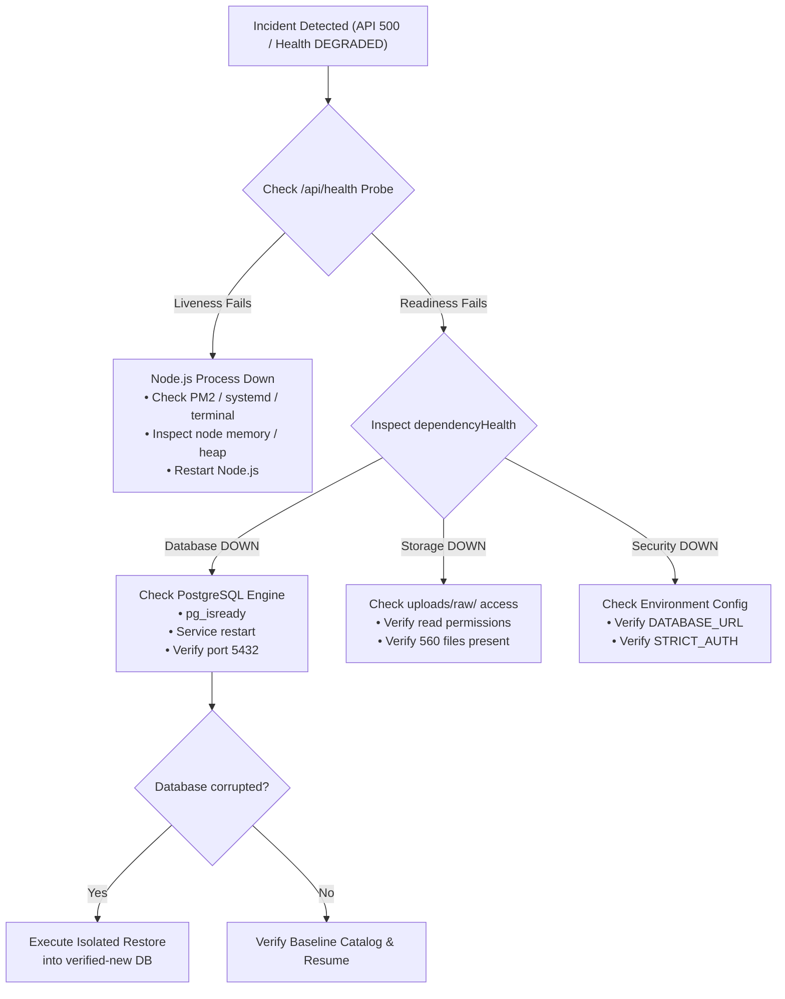

# RAKSHAK v3.0 — PHASE 44
# OPERATIONAL RUNBOOK & RECOVERY PROCEDURES

**Phase:** 44 — Operational Resilience, Backup Recovery & Service Health Verification  
**Author:** Rakshak Quality & Security Baseline Automation  
**Date:** 2026-10-27  
**Audience:** System Administrators, Security Engineers, and Test Operators  
**Operational Status:** READY FOR CONTROLLED SYNTHETIC-DATA TESTING — BACKUP, RESTORE & OPERATIONAL RECOVERY VERIFIED  

---

## 1. Routine Operational Health Verification

### 1.1 Process Liveness Verification
Check whether the Node.js application process is alive and responding:
```bash
curl -s http://127.0.0.1:3000/api/health?probe=liveness
```
**Expected Response:** HTTP 200 OK with `{"status":"ALIVE","liveness":"UP"}`.

### 1.2 Service Readiness & Dependency Verification
Check whether all dependent services (PostgreSQL, immutable cold storage, environment configuration) are ready to accept workloads:
```bash
curl -s -i http://127.0.0.1:3000/api/health
```
**Expected Response:** HTTP 200 OK with `X-Rakshak-Readiness: READY`, `status: "HEALTHY"`.

### 1.3 Database Daemon Health
Verify local PostgreSQL daemon status via CLI:
```powershell
& "C:\Program Files\PostgreSQL\16\bin\pg_isready.exe" -h 127.0.0.1 -p 5432
```
**Expected Output:** `127.0.0.1:5432 - accepting connections`.

---

## 2. Safe Synthetic Database Backup Procedure

> [!IMPORTANT]
> Never create backups using live operational data or by modifying protected historical databases (`rakshak_phase26_test` through `rakshak_phase43_test`). Always use a dedicated synthetic database.

### Step 1: Confirm Target Database Scope
Verify that the target database contains synthetic data only and does not match any protected database:
```powershell
$env:PGPASSWORD = "change_me_in_vault"
& "C:\Program Files\PostgreSQL\16\bin\psql.exe" -U postgres -h 127.0.0.1 -c "SELECT count(*) FROM pg_database WHERE datname = 'rakshak_phase44_backup_test';"
```

### Step 2: Execute Custom Format Backup
Run `pg_dump` with custom compressed archive format (`-F c`), large objects (`-b`), and verbose output:
```powershell
$timestamp = (Get-Date -Format "yyyy-MM-ddTHH-mm-ss")
$backupPath = "backups\phase44\rakshak_synthetic_backup_$timestamp.dump"
$env:PGPASSWORD = "change_me_in_vault"
& "C:\Program Files\PostgreSQL\16\bin\pg_dump.exe" -h 127.0.0.1 -U postgres -F c -b -v -f $backupPath "rakshak_phase44_backup_test"
```

### Step 3: Compute Checksum Digest & Record Metadata
```powershell
Get-FileHash -Algorithm SHA256 $backupPath
```
Record the SHA-256 hash, size, and timestamp in the backup audit register.

### Step 4: Validate Backup Table of Contents (TOC)
```powershell
& "C:\Program Files\PostgreSQL\16\bin\pg_restore.exe" -l $backupPath | Select-String -Pattern "TABLE DATA"
```
Ensure table definitions, data, and row-level security policies appear in the TOC listing.

---

## 3. Backup Validation & Safe Restore Procedure

> [!CAUTION]
> NEVER point a restore command at an existing operational or protected database. A restore rehearsal MUST always target a verified-new, isolated database.

### Step 1: Verify Target Database Isolation
Verify that the intended restore database does NOT currently exist:
```powershell
$targetDb = "rakshak_phase44_restore_test"
$env:PGPASSWORD = "change_me_in_vault"
& "C:\Program Files\PostgreSQL\16\bin\psql.exe" -U postgres -h 127.0.0.1 -t -A -c "SELECT count(*) FROM pg_database WHERE datname = '$targetDb';"
```
If output is `0`, proceed. If output is `1`, STOP immediately.

### Step 2: Create Empty Target Database
```powershell
$env:PGPASSWORD = "change_me_in_vault"
& "C:\Program Files\PostgreSQL\16\bin\psql.exe" -U postgres -h 127.0.0.1 -c "CREATE DATABASE `"$targetDb`";"
```

### Step 3: Execute Restore Command
```powershell
$env:PGPASSWORD = "change_me_in_vault"
& "C:\Program Files\PostgreSQL\16\bin\pg_restore.exe" -h 127.0.0.1 -U postgres -d $targetDb --no-owner --role=postgres -v $backupPath
```

### Step 4: Mandatory Post-Restore Verification
Run the automated security baseline auditor:
```powershell
node scripts/validate_security_baseline.mjs $targetDb
```
Verify that all 31 tables, 20 RLS tables, 20 FORCE RLS tables, and 21 policies pass catalog verification.

---

## 4. Diagnosis & Incident Escalation Workflow



---

## 5. Explicit Prohibited Operations

The following actions are strictly forbidden under all operational protocols:

1. **NO DESTRUCTIVE MUTATION OF COLD STORAGE:**
   Never delete, modify, overwrite, rename, or regenerate any file inside [`uploads/raw/`](file:///e:/Rakshak/uploads/raw/) (560 files).
2. **NO RESET OF DEV.DB:**
   Never run `prisma migrate reset`, `rm prisma/dev.db`, or DDL migrations against [`prisma/dev.db`](file:///e:/Rakshak/prisma/dev.db).
3. **NO RESTORE TO PROTECTED DATABASES:**
   Never specify any database from `rakshak_phase26_test` through `rakshak_phase43_test` as a restore target.
4. **NO PRODUCTION CUTOVER:**
   Do not point live agency traffic or operational feeds to staging environments.
5. **NO SECRET EMBEDDING:**
   Never commit unencrypted passwords, JWT signing keys, or authentication tokens into test scripts, logs, or reports.
6. **NO RLS OR CUSTODY LOOSENING:**
   Never remove `FORCE ROW LEVEL SECURITY`, drop check constraints on `CustodyEvent`, or disable audit logging to work around test failures.
